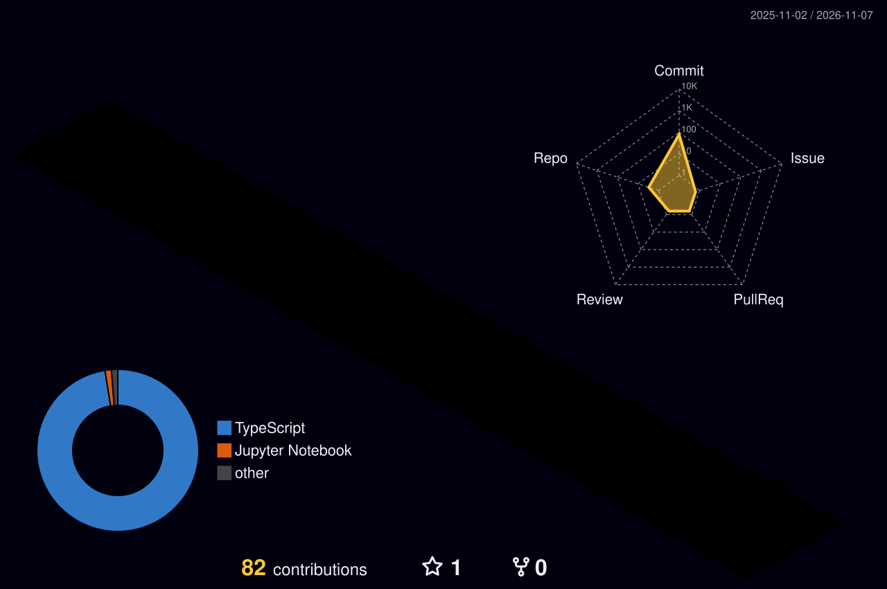

<h1 align="center">Hi there, I'm Tanmay Pawar 👋</h1>

  

  
  
  

---

### 🚀 About Me
- 🎓 Graduate student at **Northeastern University**, Boston
- 🔭 Working on **agentic RAG**, LLM-powered apps, and data pipelines
- 🌱 Exploring **Snowflake / Snowpark**, AI safety, and iOS with Swift
- 💬 Ask me about **Python, data engineering, and information retrieval**

### 🛠️ Tech Stack

  

### 📌 Featured Projects
| Project | Description |
|---|---|
| [agentic-rag](https://github.com/Tanmay6461/agentic-rag) | Agentic retrieval-augmented generation pipeline |
| [AI-Powered-Career-Platform](https://github.com/Tanmay6461/AI-Powered-Career-Platform) | AI-driven career assistance platform |
| [openclaw-safety](https://github.com/Tanmay6461/openclaw-safety) | Safety tooling in TypeScript |
| [Clinical_data_extraction](https://github.com/Tanmay6461/Clinical_data_extraction) | Structured extraction from clinical data |
| [mochi](https://github.com/Tanmay6461/mochi) | iOS app built with Swift |

---

### 📊 GitHub Stats

  
  

  

### 📈 Contribution Graph

  

### 🌆 3D Contribution Graph

  <picture>
    <source media="(prefers-color-scheme: dark)" srcset="./profile-3d-contrib/profile-night-rainbow.svg" />
    <source media="(prefers-color-scheme: light)" srcset="./profile-3d-contrib/profile-gitblue.svg" />
    
  </picture>

  

